<div align="center">



<p>
  <a href="https://www.npmjs.com/package/japofc-qr"></a>
  <a href="https://www.npmjs.com/package/japofc-qr"></a>
  <a href="https://github.com/JAPofc/japqr/actions/workflows/ci.yml"></a>
  <a href="https://www.npmjs.com/package/japofc-qr"></a>
  <a href="LICENSE"></a>
  
</p>

<p>
  <a href="#installation">Installation</a> ·
  <a href="#quick-start">Quick start</a> ·
  <a href="#api">API</a> ·
  <a href="#output">Output</a> ·
  <a href="#errors">Errors</a>
</p>

<p>
  <sub>
    English &nbsp;|&nbsp;
    <a href="docs/README.id.md">Bahasa Indonesia</a>
  </sub>
</p>

</div>

---

## Features

| | |
| --- | --- |
| ⚡ **Zero dependencies** | Nothing to install, audit or bundle but the library itself. |
| 🎯 **All 40 versions** | Every version, every error-correction level, all 8 mask patterns. |
| 🔀 **Smart segmentation** | Text is split into numeric / alphanumeric / byte runs and merged only when it saves bits. |
| 🛡️ **Automatic ECC boosting** | Uses the highest error-correction level the payload still fits into. |
| 📇 **Payload builders** | Wi-Fi, vCard, calendar, geo and WhatsApp payloads, escaped correctly for each format. |
| 🖼️ **Four output formats** | SVG, terminal, `<canvas>` and data URL, plus the raw boolean matrix. |
| 📦 **Dual builds** | ESM and CommonJS behind a standard `exports` map, with TypeScript declarations. |

<p align="center">
  
  <br>
  <sub>Scan to open the repository</sub>
</p>

---

## Installation

```bash
npm install japofc-qr
```

```bash
pnpm add japofc-qr
yarn add japofc-qr
bun add japofc-qr
```

Node.js 22+ or any modern browser. No dependencies, no native modules.

<details>
<summary><strong>Use it from a CDN</strong></summary>

```html
<script type="module">
  import { QrCode } from 'https://cdn.jsdelivr.net/npm/japofc-qr@1/dist/esm/index.js';
  document.body.innerHTML = QrCode.encodeText('Hello from a CDN').toSvgString();
</script>
```

</details>

---

## Quick start

### Node.js

```js
import { QrCode } from 'japofc-qr';

const qr = QrCode.encodeText('https://github.com/JAPofc/japqr');

qr.version; // 4
qr.size;    // 33
qr.ecc;     // 'high'
qr.mask;    // 0-7

const svg = qr.toSvgString();      // SVG document
const art = qr.toTerminalString(); // printable in a terminal
const raw = qr.toMatrix();         // boolean[][]
```

### CommonJS

```js
const { QrCode } = require('japofc-qr');

const qr = QrCode.encodeText('https://example.com');
console.log(qr.toSvgString());
```

### Browser

With a bundler, import the package normally:

```js
import { QrCode } from 'japofc-qr';
```

Without one — a plain `<script type="module">` or a single HTML file — point the
bare specifier at a CDN with an import map:

```html
<script type="importmap">
  { "imports": { "japofc-qr": "https://cdn.jsdelivr.net/npm/japofc-qr/+esm" } }
</script>

<script type="module">
  import { QrCode } from 'japofc-qr';

  const qr = QrCode.encodeText('https://example.com', { ecc: 'high' });

  // Paint an existing canvas
  qr.draw(document.querySelector('#qr'), { scale: 8 });

  // Or inject an inline SVG
  document.body.insertAdjacentHTML('beforeend', qr.toSvgString({ includeXmlDeclaration: false }));

  // Or use a data URL in an 
  document.querySelector('img').src = qr.toDataUrl();
</script>
```

Or skip modules entirely with the bundled IIFE, which exposes `window.JapofcQr`:

```html
<script src="https://cdn.jsdelivr.net/npm/japofc-qr/dist/browser/japofc-qr.min.js"></script>

<script>
  const qr = JapofcQr.QrCode.encodeText('https://example.com', { ecc: 'high' });
  document.body.insertAdjacentHTML('beforeend', qr.toSvgString({ includeXmlDeclaration: false }));
</script>
```

> Browsers cannot resolve bare specifiers such as `japofc-qr` on their own —
> without an import map or a bundler the import throws
> `Failed to resolve module specifier`.

### Command line

```bash
npx japofc-qr "https://example.com" -o qr.svg

# print it in the terminal instead
npx japofc-qr "Hello, world!" --format terminal

# highest error correction, wider quiet zone, larger scale
npx japofc-qr "Top secret" --ecc high --margin 3 --scale 12
```

<details>
<summary><strong>All CLI options</strong></summary>

```
japofc-qr <text> [options]
cat payload.txt | japofc-qr [options]

  -o, --out <file>        Write to a file instead of stdout
  -f, --format <format>   svg | png | terminal | data-url | json | matrix  (default: svg)
  -e, --ecc <level>       low | medium | quartile | high  (or L, M, Q, H)
  -m, --margin <modules>  Quiet zone width in modules  (default: 4)
  -s, --scale <px>        Pixels per module for SVG output
      --mask <0-7>        Force a mask pattern  (default: automatic)
      --min-version <n>   Smallest version to consider  (1-40)
      --max-version <n>   Largest version to consider  (1-40)
      --no-boost          Disable automatic error-correction boosting
      --dark <color>      Dark module colour  (default: #000000)
      --light <color>     Light module colour  (default: #ffffff)
      --title <text>      Accessible title for the SVG
      --compact           Half-block terminal output (1 column per module)
      --no-xml            Omit the XML declaration
  -q, --quiet             Suppress the summary printed to stderr
  -h, --help              Show help
  -v, --version           Print the package version
```

</details>

---

## API

### `QrCode.encodeText(text, options?)`

Encodes a Unicode string. The text is split into numeric, alphanumeric and byte segments automatically, and the cheapest combination is chosen.

```js
QrCode.encodeText('HELLO 12345 world');
// -> alphanumeric segment "HELLO 12345 " + byte segment "world"
```

### `QrCode.encodeBinary(bytes, options?)`

Encodes raw bytes as a single byte-mode segment. Useful for binary payloads, signed tokens or pre-encoded text.

```js
QrCode.encodeBinary(new Uint8Array([0xde, 0xad, 0xbe, 0xef]));
```

### `QrCode.encodeSegments(segments, options?)`

Encodes a list of prepared segments — the escape hatch for full control.

```js
import { QrCode, QrSegment } from 'japofc-qr';

const qr = QrCode.encodeSegments(
  [QrSegment.eci(26), QrSegment.numeric('0123456789'), QrSegment.alphanumeric('HELLO WORLD')],
  { ecc: 'medium' },
);
```

### Options

| Option | Type | Default | Description |
| --- | --- | --- | --- |
| `ecc` | `'low' \| 'medium' \| 'quartile' \| 'high'` | `'medium'` | Error-correction level to start from. |
| `minVersion` | `number` | `1` | Smallest version to consider (1–40). |
| `maxVersion` | `number` | `40` | Largest version to consider (1–40). |
| `mask` | `0–7 \| 'auto'` | `'auto'` | Force a mask, or let the penalty scorer pick one. |
| `boostEcc` | `boolean` | `true` | Upgrade the ECC level while the payload still fits. |
| `eci` | `number` | – | Emit an ECI designator before the data (0–999999). |

All options are optional and validated; invalid values throw an [`InvalidArgumentError`](#errors).

### Properties

| Member | Type | Description |
| --- | --- | --- |
| `version` | `number` | Version actually used, 1–40. |
| `size` | `number` | Modules per side (`17 + 4 × version`). |
| `ecc` | `EccLevel` | Error-correction level actually used. |
| `mask` | `MaskPattern` | Mask pattern actually used. |
| `modules` | `readonly (readonly boolean[])[]` | Module colours, indexed `[y][x]`. |

### Methods

| Method | Returns | Description |
| --- | --- | --- |
| `getModule(x, y)` | `boolean` | Colour of a module; `false` outside the grid. |
| `toMatrix()` | `boolean[][]` | Mutable copy of the grid. |
| `toBinaryStrings()` | `string[]` | One `'0'`/`'1'` string per row — ideal for snapshots. |
| `toUint8Array()` | `Uint8Array` | Packed 1-bit bitmap, MSB first, rows padded to a byte boundary. |
| `toSvgString(options?)` | `string` | Standalone SVG document. |
| `toTerminalString(options?)` | `string` | Unicode block art. |
| `draw(canvas, options?)` | `void` | Paints an existing `<canvas>` element. |
| `toDataUrl(options?)` | `string` | `data:image/svg+xml` URL. |
| `toPngBuffer(options?)` | `Promise<Uint8Array>` | Encoded PNG. |
| `toPngDataUrl(options?)` | `Promise<string>` | `data:image/png;base64` URL. |
| `toBlob(options?)` | `Promise<Blob>` | SVG or PNG blob for uploads. |
| `toJSON()` | `object` | Plain object for logging and snapshot tests. |
| `QrCode.fromJSON(value)` | `QrCode` | Rebuilds a symbol from `toJSON()` output; validates the input. |

### `QrSegment`

| Static method | Description |
| --- | --- |
| `QrSegment.numeric(text)` | Decimal digits, packed 3 digits per 10 bits. |
| `QrSegment.alphanumeric(text)` | The 45-character QR alphabet (`0-9 A-Z space $%*+-./:`). |
| `QrSegment.bytes(bytes)` | Raw bytes, 8 bits each. |
| `QrSegment.utf8(text)` | A single byte segment from UTF-8 text. |
| `QrSegment.eci(value)` | Extended Channel Interpretation designator. |
| `QrSegment.fromText(text, options?)` | Automatic cost-optimal segmentation. |
| `QrSegment.isNumeric(text)` | Whether the string fits numeric mode. |
| `QrSegment.isAlphanumeric(text)` | Whether the string fits alphanumeric mode. |

Instances expose `mode`, `numChars`, `data` (the encoded bits), `totalBits(version)` and `charCountBits(version)`.

---

## Payloads

Phones recognise a handful of payload formats. `QrPayload` builds them for you,
including the escaping each format requires, so the code opens the right app
instead of a text box.

```js
import { QrCode, QrPayload } from 'japofc-qr';

// Opens the Wi-Fi settings sheet
const wifi = QrCode.encodeText(
  QrPayload.wifi({ ssid: 'Cafe JAP', password: 'kopi;enak', hidden: true }),
  { ecc: 'high' },
);

// Imports into Contacts
const contact = QrCode.encodeText(
  QrPayload.vCard({
    firstName: 'J',
    lastName: 'AP',
    organization: 'japofc',
    phone: '+6281234567890',
    email: 'hi@example.com',
  }),
  { ecc: 'high' },
);
```

| Builder | Produces |
| --- | --- |
| `wifi({ ssid, password?, security?, hidden? })` | `WIFI:T:WPA;S:…;P:…;;` |
| `vCard({ firstName, lastName, … })` | vCard 3.0, lines folded to 75 octets |
| `mecard({ … })` | `MECARD:N:…;TEL:…;;` |
| `event({ summary, start, end, … })` | iCalendar event |
| `geo({ latitude, longitude, query? })` | `geo:lat,lng` |
| `sms({ phone, body? })` | `SMSTO:…` |
| `email({ to, subject?, body? })` | `mailto:` |
| `tel(phone)` | `tel:` |
| `whatsapp({ phone, message? })` | `https://wa.me/…?text=…` |

Every builder returns a plain string, so it composes with anything else that
expects text.

---

## Output

### SVG

```js
qr.toSvgString({
  margin: 4,                       // quiet zone, in modules
  dark: '#000000',                 // dark modules
  light: '#ffffff',                // light modules
  scale: 8,                        // pixels per module; omit for a responsive SVG
  includeXmlDeclaration: true,     // prepend <?xml ...?>
  attribution: true,               // embed <!-- japofc-qr · @japofc · MIT -->
  title: 'Open the repository',    // <title> and aria-label
  id: 'qr-code',                   // optional id attribute
  className: 'qr',                 // optional class attribute
  gradient: {                      // linear gradient instead of a flat colour
    from: '#0b0f14',
    to: '#1f6feb',
    angle: 45,                     // 0 = left to right, 90 = top to bottom
  },
  logo: {                          // image drawn over the centre
    data: 'data:image/png;base64,...',
    width: 0.2,                    // fraction of the symbol width, clamped to 0.3
    opacity: 1,
  },
});
```

Dark modules are merged into horizontal runs, so even a 177×177 code produces a compact `<path>`.

```html
<svg xmlns="http://www.w3.org/2000/svg" viewBox="-4 -4 29 29" shape-rendering="crispEdges" role="img" aria-label="QR code">
  <title>QR code</title>
  <metadata>japofc-qr · @japofc · MIT</metadata>
  <rect x="-4" y="-4" width="29" height="29" fill="#ffffff"/>
  <path fill="#000000" d="M0 0h7v1h-7z..."/>
</svg>
```

#### Gradient and logo

`gradient` replaces the flat `dark` fill with a `<linearGradient>`. Keep both
stops dark enough to stay readable by scanners, and keep the contrast with
`light` high.

`logo` paints an image over the centre of the symbol. **It covers the modules
underneath it**, so the payload survives only through error correction: encode
with `ecc: 'high'` and keep the logo under a fifth of the symbol width. The
option is clamped to `0.3`, which is the point where consumer cameras start to
fail.

```js
const qr = QrCode.encodeText('https://example.com', { ecc: 'high' });
qr.toSvgString({
  gradient: { from: '#0b0f14', to: '#1f6feb', angle: 45 },
  logo: { data: logoDataUrl, width: 0.18 },
});
```

#### Storing and restoring a symbol

`toJSON()` returns a plain object, and `fromJSON()` rebuilds an identical
symbol from it — useful for caching or moving a code across a process boundary
without re-encoding. Malformed input throws `InvalidArgumentError` rather than
producing a matrix that cannot be scanned.

```js
const cached = JSON.parse(fs.readFileSync('qr.json', 'utf8'));
const qr = QrCode.fromJSON(cached);
```

### Terminal

```js
console.log(qr.toTerminalString({ dark: '██', light: '  ', margin: 2 }));
```

```text
    ██████████████  ██  ██████████
    ██          ██        ██    ██
    ██  ██████  ██  ████  ██  ██
    ...
```

The default uses two columns per module to keep the matrix square, so a dense
symbol outgrows the terminal quickly: a version 17 code needs 178 columns.

`compact` packs two modules into one character cell with the half-block glyphs
`▀`, `▄` and `█`, halving both dimensions. The same version 17 code becomes
**45 rows × 89 columns** — the only mode that fits a normal 80 to 120 column
terminal, and the right choice for CLI tools such as WhatsApp pairing codes.

```js
console.log(qr.toTerminalString({ compact: true }));
```

```text
  █▀▀▀▀▀█ ▄▄▀█▄ █ █▀▄█ ▀█████▄▀█ ▄█▀█▀▀▀▄██▄
  █ ███ █ █▄▀▄▀ ▄▄ █▄█ ▄▄▀  ▄▄ ▄ ▄▀█   █ ██ ▀
  █ ▀▀▀ █ █  █ █▀ ▄   ▀▄▄█▀▀▀▀█ ▀▀▀█ ██ ▀▄
  ...
```

`compact` ignores `dark` and `light`; the quiet zone stays clear in both
`invert` modes, so a dark terminal keeps its background.

#### Shapes, themes, frames and animation

| Option | Values | Effect |
| --- | --- | --- |
| `shape` | `square` (default), `dot`, `rounded`, `diamond` | Redraws the data modules. The three finder patterns always stay square, because that is what a camera locks onto. |
| `theme` | `minimal`, `neon`, `glass`, `ink` | Sets palette, quiet zone and shape in one call. |
| `frame` | `true` or `{ label, brand, padding, cornerRadius }` | Wraps the code in a card with a call to action and a signature. |
| `animate` | `boolean` | Sweeps a highlight down the symbol, clipped to the code so the quiet zone stays clean. |

Explicit options always win over the theme, and passing a `dark` colour drops the
theme's gradient — otherwise the colour you asked for would be silently painted
over.

```js
// A finished asset rather than a bare code
qr.toSvgString({ theme: 'neon', frame: { label: 'Scan to connect' } });
```

### Canvas

```js
qr.draw(document.querySelector('#qr'), { margin: 4, scale: 8, dark: '#111', light: '#fff' });
```

### Data URL

```js
qr.toDataUrl();                     // base64
qr.toDataUrl({ encoding: 'uri' });  // percent-encoded, smaller for short codes
```

### PNG

The PNG encoder has no dependency: DEFLATE comes from the platform's
`CompressionStream` and the container is written by hand, so the same code runs
in Node, Bun, Deno and the browser. It is async because the codec is stream
based.

```js
const buffer = await qr.toPngBuffer({ scale: 8 });
await fs.promises.writeFile('qr.png', buffer);

// or as a data URL
const url = await qr.toPngDataUrl();
```

| Option | Default | Description |
| --- | --- | --- |
| `scale` | `8` | Pixels per module. |
| `margin` | `4` | Quiet zone, in modules. |
| `dark` | `#000000` | Dark module colour. Hex only: `#rgb` or `#rrggbb`. |
| `light` | `#ffffff` | Light module colour. Hex only. |

`toBlob()` wraps either format for uploads and object URLs:

```js
const blob = await qr.toBlob();                        // image/svg+xml
const png = await qr.toBlob({ type: 'image/png' });    // image/png
await fetch('/upload', { method: 'POST', body: png });
```

### Batch archive

`encodeBatch()` writes a ZIP holding one PNG per item, with no dependency. For
event tickets, member cards and stock labels: a list in, one archive out.

```js
import { encodeBatch } from 'japofc-qr';

const zip = await encodeBatch(
  attendees.map((person) => ({ name: person.id, text: person.url })),
  { png: { scale: 8 }, encode: { ecc: 'high' } },
);
await fs.promises.writeFile('badges.zip', zip);
```

Names are sanitised for every platform (`a/b` becomes `a-b`), and the archive
uses the stored method because PNG data is already compressed.

### Raw matrix

```js
for (const row of qr.modules) {
  console.log(row.map((dark) => (dark ? '##' : '  ')).join(''));
}
```

---

## Capacity

`getDataCapacity(version, ecc)` returns the number of data codewords (bytes) available. Byte-mode payloads also need 4 bits for the mode indicator plus 8 or 16 bits for the character count.

| Version | Low | Medium | Quartile | High | Modules |
| ---: | ---: | ---: | ---: | ---: | ---: |
| 1 | 19 | 16 | 13 | 9 | 21×21 |
| 5 | 108 | 86 | 62 | 46 | 37×37 |
| 10 | 274 | 216 | 154 | 122 | 57×57 |
| 20 | 861 | 669 | 485 | 385 | 97×97 |
| 30 | 1735 | 1373 | 985 | 745 | 137×137 |
| 40 | 2956 | 2334 | 1666 | 1276 | 177×177 |

```js
import { getDataCapacity } from 'japofc-qr';

getDataCapacity(40, 'low'); // 2956
```

---

## Errors

Every error extends `QrCodeError`, so one `catch` covers the whole library. Each also carries a stable machine-readable `code`.

| Class | `code` | Thrown when |
| --- | --- | --- |
| `InvalidArgumentError` | `ERR_INVALID_ARGUMENT` | An option or input is out of range or malformed. |
| `DataTooLongError` | `ERR_DATA_TOO_LONG` | The payload cannot fit `maxVersion`. |
| `UnsupportedCharacterError` | `ERR_UNSUPPORTED_CHARACTER` | Text contains characters outside the requested mode. |
| `EncodingError` | `ERR_ENCODING` | An impossible internal state was reached. |

```js
import { QrCode, DataTooLongError } from 'japofc-qr';

try {
  QrCode.encodeText('x'.repeat(10_000));
} catch (error) {
  if (error instanceof DataTooLongError) {
    console.error('Payload too large for a single QR Code.');
  }
}
```

---

## Credits

<div align="center">
  <a href="https://github.com/JAPofc">
    
  </a>
  <h3><a href="https://github.com/JAPofc">@japofc</a></h3>
  <p>Built and maintained by <a href="https://github.com/JAPofc">J.AP</a>.</p>
</div>

Implements ISO/IEC 18004. The architecture — version selection, block interleaving, penalty-scored masking — is inspired by [Nayuki's QR Code generator](https://github.com/nayuki/QR-Code-generator). This package is an independent TypeScript implementation.

## License

[MIT](LICENSE) © 2026 @japofc

The license requires the copyright notice to be preserved in copies and substantial portions of the software — including the `@japofc` attribution emitted in generated output. See [NOTICE](NOTICE).
