<div align="center">



<p>
  <a href="https://www.npmjs.com/package/japofc-qr"></a>
  <a href="https://www.npmjs.com/package/japofc-qr"></a>
  <a href="https://github.com/JAPofc/japqr/actions/workflows/ci.yml"></a>
  <a href="https://www.npmjs.com/package/japofc-qr"></a>
  <a href="../LICENSE"></a>
  
</p>

<p>
  <a href="README.id.md#instalasi">Instalasi</a> ·
  <a href="README.id.md#mulai-cepat">Mulai cepat</a> ·
  <a href="README.id.md#api">API</a> ·
  <a href="README.id.md#output">Output</a> ·
  <a href="README.id.md#error">Error</a>
</p>

<p>
  <sub>
    <a href="../README.md">English</a> &nbsp;|&nbsp; Bahasa Indonesia
  </sub>
</p>

</div>

---

## Fitur

| | |
| --- | --- |
| ⚡ **Tanpa dependensi** | Tidak ada yang perlu diinstall, diaudit, atau dibundle selain library-nya. |
| 🎯 **Seluruh 40 versi** | Semua versi, semua level error correction, semua 8 pola mask, semua 4 mode data. |
| 🔀 **Segmentasi cerdas** | Teks dipecah per run numeric / alphanumeric / byte, digabung hanya kalau hemat bit. |
| 🛡️ **ECC boosting otomatis** | Pakai level koreksi tertinggi yang masih muat. |
| 🖼️ **Semua format output** | SVG, PNG, terminal, `<canvas>`, data URL, plus matriks boolean mentah. |
| 📦 **Dual build** | ESM dan CommonJS lewat `exports` map standar, lengkap dengan deklarasi TypeScript. |

<p align="center">
  
  <br>
  <sub>Scan untuk membuka repositori</sub>
</p>

---

## Instalasi

```bash
npm install japofc-qr
```

```bash
pnpm add japofc-qr
yarn add japofc-qr
bun add japofc-qr
```

Node.js 22+ atau browser modern. Tanpa dependensi, tanpa modul native.

---

## Mulai cepat

### Node.js

```js
import { QrCode } from 'japofc-qr';

const qr = QrCode.encodeText('https://github.com/JAPofc/japqr');

qr.version; // 4
qr.size;    // 33
qr.ecc;     // 'high'
qr.mask;    // 0-7

const svg = qr.toSvgString();      // dokumen SVG
const art = qr.toTerminalString(); // bisa langsung dicetak di terminal
const raw = qr.toMatrix();         // boolean[][]
```

### CommonJS

```js
const { QrCode } = require('japofc-qr');

const qr = QrCode.encodeText('https://example.com');
console.log(qr.toSvgString());
```

### Browser

Kalau pakai bundler, import seperti biasa:

```js
import { QrCode } from 'japofc-qr';
```

Tanpa bundler — `<script type="module">` polos atau satu file HTML — arahkan
bare specifier ke CDN lewat import map:

```html
<script type="importmap">
  { "imports": { "japofc-qr": "https://cdn.jsdelivr.net/npm/japofc-qr/+esm" } }
</script>

<script type="module">
  import { QrCode } from 'japofc-qr';

  const qr = QrCode.encodeText('https://example.com', { ecc: 'high' });

  // Gambar ke canvas yang sudah ada
  qr.draw(document.querySelector('#qr'), { scale: 8 });

  // Atau sisipkan SVG inline
  document.body.insertAdjacentHTML('beforeend', qr.toSvgString({ includeXmlDeclaration: false }));

  // Atau pakai data URL untuk 
  document.querySelector('img').src = qr.toDataUrl();
</script>
```

Atau lewati module sama sekali dengan bundle IIFE, yang membuka
`window.JapofcQr`:

```html
<script src="https://cdn.jsdelivr.net/npm/japofc-qr/dist/browser/japofc-qr.min.js"></script>

<script>
  const qr = JapofcQr.QrCode.encodeText('https://example.com', { ecc: 'high' });
  document.body.insertAdjacentHTML('beforeend', qr.toSvgString({ includeXmlDeclaration: false }));
</script>
```

> Browser tidak bisa me-resolve bare specifier seperti `japofc-qr` sendirian —
> tanpa import map atau bundler, import-nya melempar
> `Failed to resolve module specifier`.

### Command line

```bash
npx japofc-qr "https://example.com" -o qr.svg

# tampilkan langsung di terminal
npx japofc-qr "Halo, dunia!" --format terminal

# error correction tertinggi, quiet zone lebih lebar, skala lebih besar
npx japofc-qr "Rahasia" --ecc high --margin 3 --scale 12

# styling: tema, frame, animasi
npx japofc-qr "https://example.com" --theme neon --frame-label "Scan untuk terhubung" -o kartu.svg

# batch: satu ZIP berisi satu PNG per entri
npx japofc-qr --zip batch.json -o batch.zip
```

---

## API

### `QrCode.encodeText(text, options?)`

Mengencode string Unicode. Teks otomatis dipecah menjadi segmen numeric, alphanumeric, dan byte, lalu dipilih kombinasi yang paling hemat bit.

```js
QrCode.encodeText('HALO 12345 dunia');
// -> segmen alphanumeric "HALO 12345 " + segmen byte "dunia"
```

> Catatan: mode alphanumeric standar QR hanya menerima huruf besar A–Z. Huruf kecil otomatis masuk ke mode byte.

### `QrCode.encodeBinary(bytes, options?)`

Mengencode byte mentah sebagai satu segmen byte. Cocok untuk payload biner, token bertanda tangan, atau teks yang sudah di-encode.

```js
QrCode.encodeBinary(new Uint8Array([0xde, 0xad, 0xbe, 0xef]));
```

### `QrCode.encodeSegments(segments, options?)`

Mengencode daftar segmen yang sudah disiapkan — pintu keluar untuk kontrol penuh.

```js
import { QrCode, QrSegment } from 'japofc-qr';

const qr = QrCode.encodeSegments(
  [QrSegment.eci(26), QrSegment.numeric('0123456789'), QrSegment.alphanumeric('HELLO WORLD')],
  { ecc: 'medium' },
);
```

### Opsi

| Opsi | Tipe | Default | Keterangan |
| --- | --- | --- | --- |
| `ecc` | `'low' \| 'medium' \| 'quartile' \| 'high'` | `'medium'` | Level error correction awal. |
| `minVersion` | `number` | `1` | Versi terkecil yang dipertimbangkan (1–40). |
| `maxVersion` | `number` | `40` | Versi terbesar yang dipertimbangkan (1–40). |
| `mask` | `0–7 \| 'auto'` | `'auto'` | Paksa pola mask, atau biarkan skor penalty memilih. |
| `boostEcc` | `boolean` | `true` | Naikkan level ECC selama payload masih muat. |
| `eci` | `number` | – | Tambahkan designator ECI sebelum data (0–999999). |

Semua opsi bersifat opsional dan tervalidasi; nilai tidak valid melempar [`InvalidArgumentError`](#error).

### Properti

| Member | Tipe | Keterangan |
| --- | --- | --- |
| `version` | `number` | Versi yang benar-benar dipakai, 1–40. |
| `size` | `number` | Jumlah modul per sisi (`17 + 4 × version`). |
| `ecc` | `EccLevel` | Level error correction yang dipakai. |
| `mask` | `MaskPattern` | Pola mask yang dipakai. |
| `modules` | `readonly (readonly boolean[])[]` | Warna modul, diindeks `[y][x]`. |

### Method

| Method | Return | Keterangan |
| --- | --- | --- |
| `getModule(x, y)` | `boolean` | Warna satu modul; `false` di luar grid. |
| `toMatrix()` | `boolean[][]` | Salinan grid yang bisa dimodifikasi. |
| `toBinaryStrings()` | `string[]` | Satu string `'0'`/`'1'` per baris — cocok untuk snapshot test. |
| `toUint8Array()` | `Uint8Array` | Bitmap 1-bit terpadat, MSB duluan, tiap baris dipad ke batas byte. |
| `toSvgString(options?)` | `string` | Dokumen SVG lengkap. |
| `toTerminalString(options?)` | `string` | Unicode block art. |
| `draw(canvas, options?)` | `void` | Menggambar ke elemen `<canvas>` yang sudah ada. |
| `toDataUrl(options?)` | `string` | URL `data:image/svg+xml`. |
| `toPngBuffer(options?)` | `Promise<Uint8Array>` | PNG ter-encode. |
| `toPngDataUrl(options?)` | `Promise<string>` | URL `data:image/png;base64`. |
| `toBlob(options?)` | `Promise<Blob>` | Blob SVG atau PNG untuk upload. |
| `toJSON()` | `object` | Objek polos untuk logging dan snapshot test. |
| `QrCode.fromJSON(value)` | `QrCode` | Membangun ulang simbol dari output `toJSON()`; input divalidasi. |

### `QrSegment`

| Static method | Keterangan |
| --- | --- |
| `QrSegment.numeric(text)` | Digit desimal, 3 digit per 10 bit. |
| `QrSegment.alphanumeric(text)` | Alfabet QR 45 karakter (`0-9 A-Z spasi $%*+-./:`). |
| `QrSegment.bytes(bytes)` | Byte mentah, 8 bit tiap byte. |
| `QrSegment.kanji(bytes)` | Pasangan Shift-JIS dikemas 13 bit per karakter (`0x8140-0x9FFC`, `0xE040-0xEBBF`). |
| `QrSegment.utf8(text)` | Satu segmen byte dari teks UTF-8. |
| `QrSegment.eci(value)` | Designator Extended Channel Interpretation. |
| `QrSegment.fromText(text, options?)` | Segmentasi otomatis yang paling hemat bit. |
| `QrSegment.isNumeric(text)` | Apakah string cocok untuk mode numeric. |
| `QrSegment.isAlphanumeric(text)` | Apakah string cocok untuk mode alphanumeric. |

Instance mengekspos `mode`, `numChars`, `data` (bit yang sudah diencode), `totalBits(version)`, dan `charCountBits(version)`.

---

## Payload

HP mengenali beberapa format payload. `QrPayload` membangunnya untuk kamu,
termasuk escaping yang disyaratkan tiap format, jadi kodenya membuka aplikasi
yang benar — bukan sekadar kotak teks.

```js
import { QrCode, QrPayload } from 'japofc-qr';

// Membuka pengaturan Wi-Fi
const wifi = QrCode.encodeText(
  QrPayload.wifi({ ssid: 'Cafe JAP', password: 'kopi;enak', hidden: true }),
  { ecc: 'high' },
);

// Masuk ke aplikasi Kontak
const contact = QrCode.encodeText(
  QrPayload.vCard({
    firstName: 'J',
    lastName: 'AP',
    organization: 'japofc',
    phone: '+6281234567890',
    email: 'hi@example.com',
  }),
  { ecc: 'high' },
);
```

| Builder | Menghasilkan |
| --- | --- |
| `wifi({ ssid, password?, security?, hidden? })` | `WIFI:T:WPA;S:…;P:…;;` |
| `vCard({ firstName, lastName, … })` | vCard 3.0, baris difold ke 75 oktet |
| `mecard({ … })` | `MECARD:N:…;TEL:…;;` |
| `event({ summary, start, end, … })` | Event iCalendar |
| `geo({ latitude, longitude, query? })` | `geo:lat,lng` |
| `sms({ phone, body? })` | `SMSTO:…` |
| `email({ to, subject?, body? })` | `mailto:` |
| `tel(phone)` | `tel:` |
| `whatsapp({ phone, message? })` | `https://wa.me/…?text=…` |

Semua builder mengembalikan string biasa, jadi bisa dikombinasikan dengan apa
pun yang menerima teks.

---

## Output

### SVG

```js
qr.toSvgString({
  margin: 4,                       // quiet zone, dalam modul
  dark: '#000000',                 // warna modul gelap
  light: '#ffffff',                // warna modul terang
  scale: 8,                        // pixel per modul; hilangkan untuk SVG responsif
  includeXmlDeclaration: true,     // tambahkan <?xml ...?>
  attribution: true,               // sisipkan <!-- japofc-qr · @japofc · MIT -->
  title: 'Buka repositori',        // <title> dan aria-label
  id: 'qr-code',                   // atribut id opsional
  className: 'qr',                 // atribut class opsional
  gradient: {                      // gradien linier, pengganti warna flat
    from: '#0b0f14',
    to: '#1f6feb',
    angle: 45,                     // 0 = kiri ke kanan, 90 = atas ke bawah
  },
  logo: {                          // gambar di atas tengah simbol
    data: 'data:image/png;base64,...',
    width: 0.2,                    // pecahan lebar simbol, dibatasi 0.3
    opacity: 1,
  },
});
```

Modul gelap digabung per baris horizontal, jadi kode 177×177 pun tetap menghasilkan `<path>` yang ringkas.

#### Gradien dan logo

`gradient` mengganti warna `dark` yang flat dengan `<linearGradient>`. Jaga
kedua stop tetap cukup gelap agar masih terbaca scanner, dan jaga kontrasnya
terhadap `light`.

`logo` menggambar gambar di atas tengah simbol. **Logo menutupi modul di
bawahnya**, jadi payload hanya bertahan lewat error correction: encode dengan
`ecc: 'high'` dan jaga logo di bawah seperlima lebar simbol. Opsinya dibatasi
`0.3`, titik saat kamera konsumen mulai gagal memindai.

```js
const qr = QrCode.encodeText('https://example.com', { ecc: 'high' });
qr.toSvgString({
  gradient: { from: '#0b0f14', to: '#1f6feb', angle: 45 },
  logo: { data: logoDataUrl, width: 0.18 },
});
```

#### Menyimpan dan memuat ulang simbol

`toJSON()` mengembalikan objek polos, dan `fromJSON()` membangun ulang simbol
yang identik darinya — berguna untuk cache atau memindahkan kode antar proses
tanpa encode ulang. Input yang rusak melempar `InvalidArgumentError`, bukan
matriks yang tidak bisa dipindai.

```js
const cached = JSON.parse(fs.readFileSync('qr.json', 'utf8'));
const qr = QrCode.fromJSON(cached);
```

### Terminal

```js
console.log(qr.toTerminalString({ dark: '██', light: '  ', margin: 2 }));
```

```text
    ██████████████  ██  ██████████
    ██          ██        ██    ██
    ██  ██████  ██  ████  ██  ██
    ...
```

Default-nya pakai dua kolom per modul supaya matriks tetap persegi, jadi
simbol yang padat cepat melampaui lebar terminal: kode versi 17 butuh 178
kolom.

`compact` memadatkan dua modul ke satu sel karakter lewat glyph half-block
`▀`, `▄`, dan `█`, memangkas kedua dimensi jadi setengah. Kode versi 17 yang
sama jadi **45 baris × 89 kolom** — satu-satunya mode yang muat di terminal
80 sampai 120 kolom, dan pilihan yang tepat buat CLI seperti kode pairing
WhatsApp.

```js
console.log(qr.toTerminalString({ compact: true }));
```

```text
  █▀▀▀▀▀█ ▄▄▀█▄ █ █▀▄█ ▀█████▄▀█ ▄█▀█▀▀▀▄██▄
  █ ███ █ █▄▀▄▀ ▄▄ █▄█ ▄▄▀  ▄▄ ▄ ▄▀█   █ ██ ▀
  █ ▀▀▀ █ █  █ █▀ ▄   ▀▄▄█▀▀▀▀█ ▀▀▀█ ██ ▀▄
  ...
```

`compact` mengabaikan `dark` dan `light`; quiet zone tetap kosong di kedua
mode `invert`, jadi terminal gelap tetap mempertahankan background-nya.

#### Bentuk, tema, bingkai, dan animasi

| Opsi | Nilai | Efek |
| --- | --- | --- |
| `shape` | `square` (default), `dot`, `rounded`, `diamond` | Menggambar ulang modul data. Ketiga finder pattern tetap persegi, karena itulah yang dikunci kamera. |
| `theme` | `minimal`, `neon`, `glass`, `ink` | Set palet, quiet zone, dan bentuk dalam satu panggilan. |
| `frame` | `true` atau `{ label, brand, padding, cornerRadius }` | Membungkus kode dalam kartu lengkap dengan ajakan dan tanda tangan. |
| `animate` | `boolean` | Menyapu highlight ke bawah simbol, di-clip ke kode agar quiet zone tetap bersih. |

Opsi eksplisit selalu menang atas tema, dan memberi warna `dark` menghapus
gradien tema — kalau tidak, warna yang kamu minta akan tertimpa diam-diam.

```js
// Aset jadi, bukan sekadar kode polos
qr.toSvgString({ theme: 'neon', frame: { label: 'Scan untuk terhubung' } });
```

### Canvas

```js
qr.draw(document.querySelector('#qr'), { margin: 4, scale: 8, dark: '#111', light: '#fff' });
```

Menerima opsi yang sama dengan renderer PNG, termasuk `shape`. Meminta fitur
khusus SVG seperti `logo` atau `frame` akan melempar error, bukan diam-diam
diabaikan.

### Data URL

```js
qr.toDataUrl();                     // base64
qr.toDataUrl({ encoding: 'uri' });  // percent-encoded, lebih kecil untuk kode pendek
```

### PNG

Encoder PNG-nya tanpa dependensi: DEFLATE datang dari `CompressionStream`
bawaan platform dan kontainernya ditulis manual, jadi kode yang sama jalan di
Node, Bun, Deno, dan browser. Asinkron karena codec-nya berbasis stream.

```js
const buffer = await qr.toPngBuffer({ scale: 8 });
await fs.promises.writeFile('qr.png', buffer);

// atau sebagai data URL
const url = await qr.toPngDataUrl();
```

| Opsi | Default | Keterangan |
| --- | --- | --- |
| `scale` | `8` | Pixel per modul. |
| `margin` | `4` | Quiet zone, dalam modul. |
| `dark` | `#000000` | Warna modul gelap. Hex saja: `#rgb` atau `#rrggbb`. |
| `light` | `#ffffff` | Warna modul terang. Hex saja. |
| `shape` | `square` | Bentuk modul data: `square`, `dot`, `rounded`, atau `diamond`. Finder pattern tetap kotak. |

Fitur khusus SVG (`theme`, `gradient`, `logo`, `frame`, `animate`) ditolak
dengan error yang jelas, bukan dibuang diam-diam — PNG yang logonya hilang
tidak boleh terlihat seperti PNG yang bawa logo.

`toBlob()` membungkus salah satu format untuk upload dan object URL:

```js
const blob = await qr.toBlob();                        // image/svg+xml
const png = await qr.toBlob({ type: 'image/png' });    // image/png
await fetch('/upload', { method: 'POST', body: png });
```

### Arsip batch

`encodeBatch()` menulis ZIP berisi satu PNG per item, tanpa dependensi. Untuk
tiket event, kartu anggota, dan label stok: daftar masuk, satu arsip keluar.

```js
import { encodeBatch } from 'japofc-qr';

const zip = await encodeBatch(
  peserta.map((orang) => ({ name: orang.id, text: orang.url })),
  { png: { scale: 8 }, encode: { ecc: 'high' } },
);
await fs.promises.writeFile('badge.zip', zip);
```

Nama disanitasi untuk semua platform (`a/b` menjadi `a-b`), dan arsipnya memakai
metode stored karena data PNG sudah terkompresi.

### Matriks mentah

```js
for (const row of qr.modules) {
  console.log(row.map((dark) => (dark ? '##' : '  ')).join(''));
}
```

---

## Kapasitas

`getDataCapacity(version, ecc)` mengembalikan jumlah codeword data (byte) yang tersedia. Payload byte mode juga butuh 4 bit untuk mode indicator plus 8 atau 16 bit untuk character count.

| Versi | Low | Medium | Quartile | High | Modul |
| ---: | ---: | ---: | ---: | ---: | ---: |
| 1 | 19 | 16 | 13 | 9 | 21×21 |
| 5 | 108 | 86 | 62 | 46 | 37×37 |
| 10 | 274 | 216 | 154 | 122 | 57×57 |
| 20 | 861 | 669 | 485 | 385 | 97×97 |
| 30 | 1735 | 1373 | 985 | 745 | 137×137 |
| 40 | 2956 | 2334 | 1666 | 1276 | 177×177 |

```js
import { getDataCapacity } from 'japofc-qr';

getDataCapacity(40, 'low'); // 2956
```

---

## Error

Semua error turunan `QrCodeError`, jadi satu `catch` cukup untuk seluruh library. Tiap error juga membawa `code` yang stabil dan bisa dibaca mesin.

| Class | `code` | Dilempar saat |
| --- | --- | --- |
| `InvalidArgumentError` | `ERR_INVALID_ARGUMENT` | Opsi atau input di luar rentang, atau bentuknya salah. |
| `DataTooLongError` | `ERR_DATA_TOO_LONG` | Payload tidak muat di `maxVersion`. |
| `UnsupportedCharacterError` | `ERR_UNSUPPORTED_CHARACTER` | Teks mengandung karakter di luar mode yang diminta. |
| `EncodingError` | `ERR_ENCODING` | Kondisi internal yang seharusnya mustahil. |

```js
import { QrCode, DataTooLongError } from 'japofc-qr';

try {
  QrCode.encodeText('x'.repeat(10_000));
} catch (error) {
  if (error instanceof DataTooLongError) {
    console.error('Payload terlalu besar untuk satu QR Code.');
  }
}
```

---

## Kredit

<div align="center">
  <a href="https://github.com/JAPofc">
    
  </a>
  <h3><a href="https://github.com/JAPofc">@japofc</a></h3>
  <p>Dibuat dan dirawat oleh <a href="https://github.com/JAPofc">J.AP</a>.</p>
</div>

Mengimplementasikan ISO/IEC 18004. Arsitekturnya — pemilihan versi, interleaving blok, masking berbasis skor penalty — terinspirasi dari [QR Code generator milik Nayuki](https://github.com/nayuki/QR-Code-generator). Package ini implementasi TypeScript independen.

## Lisensi

[MIT](../LICENSE) © 2026 @japofc

Lisensi ini mewajibkan notice hak cipta tetap disertakan pada salinan dan bagian substansial dari software — termasuk atribusi `@japofc` pada output yang dihasilkan. Lihat [NOTICE](../NOTICE).
